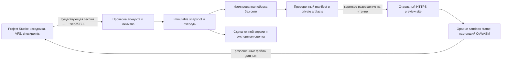

# C++ Gold Standard — CPP-QT-PRODUCTION-0

28.10.2026. Поручение MASTER 00 от 28.10.2026. Режим: очень высокий для runtime/security, высокий для методики. Рабочая ветка `feature/academy-gold-standard-cpp-module-6`. Исследованный HEAD `8af443f1e6f49217e85bef60e8b605e0b5d221d4`; GitHub main проверен перед работой и повторно: `d76d1613a1fbf6726d453e40366c306ea502d4c7`.

## STATUS

**Preflight выполнен; допуск Qt в production — PARTIAL. COURSE-FINAL — PLANNED.** Рекомендация: изолированная серверная сборка + настоящее Qt/WASM-приложение внутри Nexus. Учащемуся не нужна внешняя IDE; переносимый экспорт остаётся дополнительной возможностью.

| Статус | Что означает в этом комплекте |
|---|---|
| IMPLEMENTED в feature | Многофайловый TaskFlow, Qt 6.8.3/Emscripten 3.1.56 target, отдельный preview, VFS-данные, Stop/Restart, ZIP, snapshot сдачи и назначенный преподаватель для одного задания |
| Ранее AUTOMATED PASS, не повторялся | Source `1a3f9e5`, CI [40643526052](https://github.com/qsqgjhngyt-maker/akronikl-it-nexus/actions/runs/40643526052): 8/8 SUCCESS. M6: 110 native +110 WASI, M1–5:940 случаев;5 Qt bundles/12 E2E/5 a11y;67 lesson IDs и40 legacy; NEXUS-PERF-01 PASS |
| Новые AUTOMATED PASS | Инвентаризация SDK; одна реальная сборка TaskFlow; запуск и C++-событие в Chromium и отдельном iframe при390px; ограниченные HTTP/storage проверки |
| Новая подтверждённая проблема | Изменённый после сборки `program.js` возвращается HTTP200 при несовпадении с SHA256 manifest. Проверка защиты — FAIL, воспроизведение — PASS |
| PLANNED | Production runner/storage/ingress, лицензионный комплект, очередь и эксплуатационные лимиты, физическая приёмка, COURSE-FINAL и его общая система попыток |
| Не выдан | Новый LIVE PASS/FULL LIVE PASS, production Qt admission, юридическое разрешение, подтверждение академической эквивалентности университету |

Продуктовые файлы, учебные M1–6, main, production, IAM/OAuth/D1/Cloud, платные ресурсы и официальный релиз этим этапом не изменены. Предыдущий M6 feature PASS сохраняется; его предмет не включал допуск публичного многопользовательского сервиса.

## QT RUNTIME OPTIONS

| Вариант | Возможности и доказательства | Ограничения, риски и расходы | Решение |
|---|---|---|---|
| A. Компиляция произвольного C++/Qt и исполнение полностью в браузере | Теоретически возможен отдельный порт компилятора/линкера и SDK. В текущем Nexus такого пути нет. Существующий Clang/WASI не заменяет Emscripten/Qt ABI, moc и Qt build tools | Не измерены размер браузерного compiler payload, peak RAM, скорость, мобильная совместимость. Нужны порт host tools, файловая система, linker/sysroot/Qt libraries, отмена и Offline-cache gate. Трафик и хранение остаются расходами; лицензионные обязательства Qt не исчезают | Отдельное R&D, не ближайший production путь. Готовое Qt/WASM demo доказывает исполнение, а не компиляцию нового C++ пользователя |
| B. Изолированная серверная сборка; исполнение Qt/WASM в браузере | Уже реализованный feature-пилот. В новом локальном опыте неизменённый TaskFlow собран за22,990s; собственный C++ callback сработал внутри Nexus и узкого iframe | Нужны защищённый runner, HTTPS-preview, постоянное хранилище, справедливый доступ, лицензии, эксплуатация и сеть для сборки. Сервер получает исходники, следовательно нужны понятные правила приватности и хранения | **Рекомендуется**, после закрытия перечисленных gates |
| C. Серверный native Qt + передача изображения/событий | В этом репозитории не реализован и не испытан | GUI-процесс, дисплей и поток на каждую сессию; выше расходы, сложнее доступность, мобильный ввод, данные и изоляция. Offline не решает. Лицензионные условия конкретной серверной модели всё равно требуют проверки | Резерв для будущих задач, которые объективно нельзя выполнить в WASM; для нынешнего M6 необходимость не доказана |

SDK содержит Linux/amd64 host tools. Размер установленного образа804286034B; host Qt194844867B, wasm Qt83410712B, Emscripten sysroot368344888B. Это **локальные размеры**, не размер скачивания возможного браузерного компилятора и не доказательство его невозможности.

Сочетание Qt6.8/Emscripten3.1.56 указано в [таблице поддерживаемых платформ Qt6.8](https://doc.qt.io/qt-6.8/supported-platforms.html). В установленном Qt6.8.3 `qconfig.pri` фиксирует `QT_EMCC_VERSION=3.1.56`, toolchain helper рекомендует3.1.56, файл версии Emscripten тоже3.1.56; совпадение проверено автоматически, хеши файлов записаны. Поставщик требует отдельного тестирования мобильных браузеров. Совпадение toolchain не заменяет испытание конкретных устройств.

## RECOMMENDED ARCHITECTURE

**PLANNED для production.** Сначала один выделенный Linux runner с постоянным диском и отдельным preview site; публичный BFF не должен принимать команды/image/owner от клиента. Docker daemon и build worker — отдельная доверенная зона с минимальными полномочиями, без доступа к базе аккаунтов, Cloud secrets и домашним каталогам пользователей. Не помещать compiler containers внутрь существующего ephemeral Serverless runtime и не давать ему host Docker socket.

Последовательность: зафиксировать snapshot → проверить owner/версию/квоту → выдать job ID → собрать Qt/Emscripten → проверить разрешённый набор файлов, размеры и хеши → атомарно опубликовать → запустить в отдельном iframe. GUI остаётся внутри Nexus. Тестирование модели выполняется отдельно; успешная сборка или CTest не равны окончательной оценке.

Существующий пилот запускает Qt singlethread. Потоки, QtQuick, дополнительные Qt modules, JSPI/Asyncify, сетевые API и иной toolchain в этот допуск не входят. Отдельный HTTPS site нужен для изоляции от аккаунта и отзывчивости; на публичном ingress обязателен настоящий TLS. Локальный QA TLS не является production-сертификатом. Нельзя глобально включать COOP/COEP/новый cookie scope ради будущих потоков без отдельной проверки Identity/PWA.

## SECURITY

**Уже есть в feature:** default deny при выключенном build flag; server-side account proof через существующий account-read; expected-account проверка; ограничение Origin/Host/методов; private snapshot; owner ACL и явное назначение преподавателя; отзыв preview и отмена сборок при выходе. В новых синтетических проверках другой аккаунт получил404, чужой Origin403, отозванный preview404. Реальный production transport/logout forwarding этим не доказан.

Runner: `--network none`, read-only root/input, UID1000, `cap-drop ALL`, `no-new-privileges`,128PIDs,2CPU,2GiB,180s на операцию,128KiB logs,64MiB на artifact/96MiB суммарно. `/work` и `/tmp` — временные; writable host bind/Docker socket внутрь сборки не передаются. Пользовательский CMake и native tests всё равно исполняют недоверенный код: контейнер делит ядро с host. Перед публичным multi-tenant запуском нужны решение об усиленной изоляции (например, отдельный disposable worker/microVM), patch policy, защита Docker control plane и abuse-тесты. Названия технологий здесь — альтернативы, не выполненная установка.

Preview: `sandbox allow-scripts` без `allow-same-origin`; отдельный site; CSP default-src none, ограниченные scripts/connect, запрет forms/base/лишних permissions; parent проверяет source/window/opaque origin/nonce/snapshotHash. Capability имеет случайный token и TTL120s. **Это разрешение предъявителя, а не ACL-сессия**: знающий ссылку может читать до отзыва/истечения. URL нельзя отправлять в analytics, GitHub или обычные access logs. CORS `*` у артефактов не является проверкой владельца.

Новый дефект **QT-PROD-P1-01**: hashes фиксируются при сборке, но artifact handler сверяет только имя со списком и затем читает диск. В probe изменённый валидный JS получил200 с неверным SHA256. Код в этом fault probe не исполнялся. До допуска нужны trusted manifest, проверка hash/bytes **до отправки заголовков и исполнения**, атомарные immutable artifacts, безопасная ошибка при отсутствующем файле и тесты missing/corrupt/stale/замены во время чтения. Хеш внутри недоверенного самого bundle недостаточен; verifier/manifest должны приходить из доверенной части. Это сохранено как OPEN, не замаскировано зелёным тестом.

Новый эксплуатационный риск **QT-PROD-P1-02**: handler использует `readFile`, а числа одновременных скачиваний/байтов в секунду на account/host нет. Compile quota не ограничивает повторные GET. Перед публичным запуском нужны ограниченная выдача/очередь, лимиты соединений и памяти, отмена при disconnect, negative tests; поток выдачи обязан сохранять проверку целостности. Нагрузочная устойчивость сейчас не измерена.

Sandbox не задаёт браузерную CPU/RAM-квоту. Прежний Stop бесконечного callback измерен только в Chromium с разделением site. Это нельзя переносить на iPhone/Android/Firefox. Нужны физические hang/OOM/background/resume тесты с сохранностью editor и последних данных. Проверка origin в пилоте сравнивает последние две метки hostname; production домены нужно проверять по реальному registrable site, а не считать эту эвристику Public Suffix List.

## LICENSING

**Юридический gate открыт.** Инвентаризирован SPDX из установленного SDK:92 package entries. Это не92 доказанно включённых в конкретный WASM компонентов и не полный SBOM контейнера. Core/Gui/Widgets допускают несколько лицензий, но **QWasmIntegrationPlugin — `LicenseRef-Qt-Commercial OR GPL-3.0-only`**, встроенный DejaVu2.37 — Bitstream-Vera. Тот же GPL/commercial заголовок есть у реально используемого loader и [plugin source6.8.3](https://raw.githubusercontent.com/qt/qtbase/v6.8.3/src/plugins/platforms/wasm/qwasmintegration.cpp); [qtloader.js6.8.3](https://raw.githubusercontent.com/qt/qtbase/v6.8.3/src/plugins/platforms/wasm/qtloader.js). Текущая [официальная Qt/WASM страница, раздел License](https://doc.qt.io/qt-6/wasm.html#license) подтверждает общий GPLv3/commercial выбор; её новые возможности не приписываются6.8.3.

**Обычный LGPL relink-kit не покрывает GPL-only platform plugin.** Статически связанный WASM и JS скачиваются в браузер; вынесение компилятора на сервер само по себе не устраняет распространение копии. Требования GPLv3 §§5–6 к соответствующему исходному коду, уведомлениям и правам получателя нужно выполнить для конкретной поставки. Это вывод preflight, требующий юридической проверки границ combined work; не решение автоматически перелицензировать Nexus или работы учащихся. [Текст GPLv3 из поставки Qt6.8.3](https://raw.githubusercontent.com/qt/qtbase/v6.8.3/LICENSES/GPL-3.0-only.txt).

| Маршрут для решения владельца | Что потребуется до публикации |
|---|---|
| GPLv3-совместимые учебные GUI-приложения | Согласовать лицензии starter и contributions; давать получателям точный corresponding source Qt/приложения/нужных scripts и notices, воспроизводимую сборку; исключить secrets и защищённые ответы экзамена. Не требуется автоматически размещать личные работы в публичном GitHub, но нельзя обещать получателю запрет перераспространения, противоречащий GPL |
| Коммерческая Qt | Письменно подтвердить допустимость SaaS compiler, учащихся, CI/runner, browser distribution и экспорта; стоимость и количество лицензий из договора. Одна лицензия разработчика или образовательная льгота не считаются автоматически достаточными |
| Иной GUI/runtime | Новый отдельный архитектурный/учебный gate; не подмена уже назначенного Qt готовой JS-демонстрацией и не обязательный уход во внешнюю IDE |

[Лицензия Emscripten3.1.56](https://raw.githubusercontent.com/emscripten-core/emscripten/3.1.56/LICENSE) — MIT/NCSA; локальные emsdk/musl notices проверены. LLVM/libc++/Binaryen, pip/apt tools и bundled third-party требуют собственных notices и разрешённых вариантов. Список SPDX содержит NOASSERTION и LicenseRef: перед выпуском нужно разрешить их, получить build-specific dependency map, проверить fonts/logo/trademarks и полный container SBOM. Commercial Qt не отменяет обязательства третьих сторон. [Qt6.8 licensing/SBOM](https://doc.qt.io/qt-6.8/licensing.html) — источник общего порядка, не blanket-разрешение на весь SDK. Лицензии/исходники/зависимости сохранять с **конкретной версией и хешами**, включая изменения; цену коммерческой лицензии не выдумывать.

## STORAGE

**Сейчас:** local ProjectStore/checkpoints, переносимые source ZIP; на сервисе private FS, owner metadata, immutable source snapshot с hash-проверкой, atomic JSON rename. В probe перезапуск сохранил snapshot byte-for-byte. Незавершённые jobs при старте помечаются interrupted; источники не теряются. Это не тест backup/restore после гибели диска. Qt MEMFS не является диском пользователя: обратно в VFS передаются только разрешённые текстовые файлы; лимит64KiB/файл, набор ограничен application manifest.

Пилот ограничивает workspace64files/256KiB на file/1MiB суммарно, payload2MiB. Для курса это контракт, а не обещание поддержки произвольного Qt-проекта. Превышение будущего capstone должно быть выявлено заранее, а не обходиться скрытой обрезкой.

**QT-PROD-P1-03:** global200jobs без retention/GC,60jobs/hour/account, один активный job на аккаунт/два на сервис. После накопления200jobs новые сборки получают429. Даже50учащихся по4сборки могут исчерпать весь срок жизни store. Текущие2слота — немедленный отказ лишним запросам, а не справедливая учебная очередь. Перед публикацией разделить disposable build cache, сохранённые проекты/checkpoints и неизменяемые сдачи/оценки; определить quota/retention и честное UX ожидания. Не удалять защищённые работы ради освобождения cache.

**Рекомендуется:** в пилоте persistent volume с private permissions + отдельный backup с проверенным restore; после роста private object storage и durable metadata через согласованный контракт. Никакого нового D1 schema в этом этапе. Immutable artifacts по buildId+sourceHash+SDK digest, owners/версии/сдачи отдельно; cache key включает toolchain, build flags, dependencies и source. Cross-account dedup не должен раскрывать наличие чужого проекта. Старые sources/build metadata нужны для восстановления; runtime artifacts допускают ограниченный GC по ссылкам, protected submissions — только по утверждённой политике.

Порча source сейчас отвергается при чтении; порча artifact пока не отвергается. План: проверка SDK digest на старте, trusted build manifest, quarantine corrupt bundle и повторная сборка из сохранённого snapshot с явным согласием при изменении версии. Missing/stale SDK → понятная недоступность Qt, editor/console/export остаются рабочими; никакой автоматической замены пользовательского кода.

## OFFLINE

Ранее проверенные offline lessons/source/console и checkpoints сохраняются: продукт здесь не меняется. **Новая компиляция Qt, получение preview, сдача и проверка требуют сети. Полный Qt Offline не реализован и не объявляется.** Уже загруженный iframe может продолжить работу, но это не гарантия повторного запуска после закрытия/выгрузки браузером.

Нельзя включать private user bundles/capability URL в public PWA precache или скачивать SDK на старте Академии. Отдельный opaque preview не становится частью Nexus Service Worker cache автоматически. Ошибка сети не должна сбрасывать snapshot, прогресс, code/VFS или запускать Cloud PUSH/PULL.

Опциональный будущий offline-bundle — отдельный gate: opt-in download, проверенный manifest/digest, ограниченный cache LRU **только сборок**, explicit version compatibility, per-account confidentiality, safe loader/CSP и отказ без удаления работ. Перед записью `storage.estimate()`, запрос persistence где доступен, резерв места и обработка QuotaExceeded; это не гарантия постоянного хранения. WebKit документирует [quota, partitioning и eviction](https://webkit.org/blog/14403/updates-to-storage-policy/). [Storage API](https://developer.mozilla.org/en-US/docs/Web/API/Storage_API/Storage_quotas_and_eviction_criteria) не заменяет резервную копию. Старое/повреждённое поколение не активировать частично; сохранять рабочее поколение до полного подтверждения нового.

## PERFORMANCE

Новый локальный опыт: Chrome156.0.8078.49 headless, Windows host/Docker Linux, software rendering; loopback HTTPS, без реального аккаунта и WAN. Один образ `sha256:d6bcaf3ab7c3ebe08b38ea816ee67acbe366421701d99210fd355ce2a8ccb9ef`. Один проект не является распределением p95.

| Измерение | Результат и предел вывода |
|---|---|
| Реальная сборка TaskFlow | 22990ms; нажатие → working23796ms; без ожидания учебной очереди |
| Четыре artifacts | 20334126B; program.wasm19923488B; SHA256 совпали с build metadata |
| Локальное сжатие тех же bytes | gzip5942536B, Brotli quality6:4926436B; сжатая выдача **не внедрена** |
| WASM linear memory | 52428800B/50MiB после старта на desktop и390px; это не RSS/peak устройства, не JS heap и не RAM compilation |
| Новый iframe390px | Запуск и callback PASS;383ms до завершения измеренного загрузочно-функционального шага. Тот же browser context, возможен code cache; не cold-browser benchmark, не touch/mobile LIVE |
| ResourceTiming | Размеры opaque cross-origin ресурсов редактируются в0; нули не означают отсутствие трафика. Время отдельных ресурсов записано только как loopback наблюдение |

Сейчас no-store и uncompressed artifacts. При1Mbit/s передача20,334MB занимает теоретически162,7s; Brotli-варианта39,4s без RTT/декодирования/запуска. TTL120s проверяется при **начале запроса**, поэтому эта арифметика не доказывает обязательный обрыв уже начатого WASM transfer. Но поздний refetch, фон/возврат и повторное открытие после TTL дадут404; renewal/restart без ненужной пересборки ещё не реализованы (**QT-PROD-P2-01**).

План оптимизации: проверенная gzip/Brotli выдача с правильными MIME/encoding/Vary и digest исходного содержимого; отдельно измерить O0/O2/Os/Oz и reuse SDK cache, не отключая исключения/проверки ради размера. В текущем runner Release принудительно O0; другой профиль не испытан и не внедрён. [Emscripten optimization guide](https://emscripten.org/docs/optimizing/Optimizing-Code) обосновывает необходимость сравнения, а не гарантированный выигрыш любого флага.

NEXUS-PERF-01: прежний PASS75modules/591994B при75/600000, outline26769B при30000; основной lab index45357B при46000, M6index8588B при12000. Новых продуктовых bytes нет, поэтому переносится подтверждённый результат, **не выдаётся новый полный прогон**. Qt загружается только по явному действию. Предлагаемый новый gate:0Qt requests до Run, неизменные прежние лимиты, отдельные p50/p95 build/queue/load, data caps, memory/Stop/background на физических устройствах; численные SLA утверждать после пилота.

## COST

Ни один ресурс/платёж не создан. **Ниже расчёт масштаба по опубликованным примерам цен, а не подтверждённая смета по текущему billing account/SKU.** Регион, валюта, НДС/договор и текущий прайс должны быть подтверждены перед закупкой.

Для двух simultaneous jobs по2CPU/2GiB нужен ориентир4vCPU100%/8GiB RAM плюс disk/OS/service reserve; диск для SDK, временных outputs, cache и backup проектируется отдельно. Docker VM/gVisor/microVM могут изменить overhead. GPU на сервере для WASM-сборки не требуется. Только native streamingGUI потребовал бы иной sizing. При одном слоте ориентир2vCPU/4GiB.

В [официальном примере Compute](https://yandex.cloud/ru/docs/compute/pricing) использованы1,24₽/vCPU-hour и0,33₽/GiB-hour. При730h: один слот `(2×1,24+4×0,33)×730` = **2774₽/мес**, два `(4×1,24+8×0,33)×730` = **5548₽/мес** только compute. Это lower-scope иллюстрации, не обещание полной цены и не рекомендация покупать выбранный SKU без проверки.

Полная модель: `hours×(CPU×pCPU+RAM×pRAM) + diskGiB×pDisk + backupGiB×pBackup + objectGiB×pObject + PUT/GET + billableEgressGiB×pEgress + publicIP/TLS-domain/registry/monitoring + QtLicense + эксплуатация`. [Object Storage pricing](https://yandex.cloud/ru/docs/storage/pricing) отдельно учитывает хранение/операции/трафик; его пример2,376₽/GiB-month даёт237,60₽ за100GiB без льгот, но это также **пример**, не актуальная котировка выбранного класса. Диск VM и backup не заменяются этой строкой.

Сценарий нагрузки, не прогноз:20учащихся×20сборок/день×22дня =8800сборок/месяц. По измеренным размерам по одному скачиванию каждой сборки —166,65GiB без сжатия либо40,38GiB Brotli; повторные открытия/несколько получателей увеличат трафик. Compute документирует первые100GB/month без тарификации, но доступный остаток общей льготы аккаунта и точные единицы/цены не проверялись; нельзя вычитать её повторно из каждого сервиса. Worst-case200×96MiB artifacts≈18,75GiB, кроме sources/SDK/OS/backup. Default200jobs всё равно не обслуживает этот сценарий без lifecycle.

Формула минимального числа слотов для учебной группы: `ceil(N×p95buildSeconds / допустимоеОжиданиеSeconds)` плюс запас; p95 ещё не измерен. По23s одному примеру нельзя обещать пропускную способность. Runtime concurrency2 и HTTP429 сейчас требуют очереди до массовой аттестации. Дорогие auto-scale и коммерческие лицензии не выбраны; ресурсные варианты/регион/месячный предел расходов — решение владельца по готовой смете.

## ROLLBACK

На этом этапе rollback нечего исполнять: production не изменён. План точного переключения — обязательный контракт будущей публикации, **не готовая deploy-команда**.

1. До staging: закрыть P1, лицензии, reproducible SDK/manifest, backup/restore, auth/logout route и retention. Для staging выделить отдельные service/image/store/site. Создание ресурсов только после разрешения владельца.
2. Зафиксировать release tuple: main/source SHA, frontend version/assetGeneration + BUILD_MANIFEST SHA256 и полный пакет; действующие BFF image digest/revision + Gateway specification hash; flags, SDK digest, preview TLS/site, storage schema/backup IDs. Значения читать на момент разрешённого cutover; не придумывать нынешние backend revisions. Текущий main d76d161/последний подтверждённый frontend…10.9-test.2 — исходная точка, не вечная константа.
3. Новую frontend generation и backend подготовить параллельно. Flag по умолчанию OFF; сначала synthetic staging, затем разрешённый owner canary. Проверить A/B аккаунты, обычный logout/login, code/progress/projects/checkpoints, revoked preview, quota/corruption, portable ZIP, физические устройства и остановку зависания. Новый tag/release не нужен для тестовой публикации.
4. Cutover — только после отдельного решения владельца, включение ограниченной cohort; текущие frontend/backend/artifacts сохраняются. Не делать миграцию D1/авторизации в одном шаге с Qt.
5. При аварии: выключить Qt flag; остановить приём новых jobs, отменить активные и отозвать capabilities; восстановить **зафиксированный** frontend generation/entry manifest и прежний BFF/Gateway tuple. Не очищать cookies/storage и не удалять новые sources/submissions/checkpoints. Пользовательские данные/оценки сохраняются отдельно от disposable artifacts. Старый frontend может не показывать новый Qt job, но экспорт/источники должны быть доступны через безопасный recovery route.
6. После отката: обычный вход/выход, прежний account/progress/projects, console/Offline и повторный запуск старого поколения. Сравнить metadata, не публикуя личные сведения. Backend/physical FULL LIVE PASS выдавать только по фактической проверке. Restore из backup отрепетировать до cutover, а не впервые при потере диска.

## TEST RESULTS

Новые материалы: `CPP_QT_PRODUCTION_0_EVIDENCE.json`, `CPP_QT_PRODUCTION_0_COMPONENTS.json`, `CPP_QT_PRODUCTION_0_SOURCES.json`, `CPP_QT_PRODUCTION_0_HASHES.json`. Локальный пакет включает воспроизводимые harnesses и synthetic screenshots; не включает SDK/binaries, private stores, job/capability URLs, TLS keys, profiles или реальные данные.

| Проверка | Итог |
|---|---|
| Актуальный GitHub main и чистая feature до работы | PASS; d76d161/8af443f |
| SDK inventory,92SPDX entries,размеры,license headers | AUTOMATED PASS фактов; legal gate OPEN |
| HTTP/storage boundary, stub runner |7наблюдений: baseline200/hash match; tamper200/hash mismatch(**FAIL защиты**); other account404; wrong origin403; restart source unchanged; TTL+120001ms404; logout404. Это не C++ compilation test |
| Настоящая Qt сборка и C++ событие | AUTOMATED PASS; одна сборка/два контекста отображения, без production запросов |
| Artifact bytes/gzip/Brotli/linear memory | Измерены; SHA256 проверены; physicalpeak/WAN/p95 не измерены |
| Старые M1–6/05/07/PERF | Использован закрытый CI по идентичности продукта.8CI не запускались заново |
| Две попытки `emcc --version` на урезанном readonly probe | FAILED ENVIRONMENT: сначала нет writable tmp, затем нет writable EM_CACHE. Version file3.1.56 прочитан; реальная сборка с штатными tmpfs/cache PASS. Не выдаются за дефект compiler/успех version command |
| Вход/данные владельца/физический телефон | Нового LIVE нет, production не менялся, персональные сведения не читались |

## COURSE-FINAL PLAN

Отдельный [план COURSE-FINAL](CPP_COURSE_FINAL_PLAN_RU.md):3 сопоставимых варианта, exam blueprint по шести модулям, реальные изменения/диагностика/тестирование кода, substantial project, документация, защита, экспертная рубрика, повторная попытка без сброса прогресса. Предварительные веса MASTER **40/50/10** заменяют историческое предложение25/25/40/10; это не валидированная система оценивания. Skill Graph/Mastery/Learning Events/general secure auto-assessment этим планом не реализуются.

## BLOCKERS

| Gate | Статус/ответственный contract | Что закрывает |
|---|---|---|
| QT-PROD-LIC-01 | OPEN,00/02 + юридическая проверка | GPL/commercial маршрут именно WASM plugin/loader; права учащихся; corresponding source/notices; third-party/SBOM; если commercial — покрытие договора и цена |
| QT-PROD-P1-01 | OPEN,02/05 | Проверенная целостность **выдаваемых** artifacts, missing/corrupt/stale fail closed |
| QT-PROD-P1-02 | OPEN,02/01 | Ограниченная выдача, контроль памяти/соединений и граница изоляции недоверенной сборки |
| QT-PROD-P1-03 | OPEN,02/05 | Durable storage/backup restore; очередь, quota/retention без удаления работ, предел200jobs устранён проектным решением |
| QT-PROD-IDENTITY-01 | NOT TESTED LIVE,01/02 | Реальный ingress account proof/logout-revoke/expected-account без новых JS secrets/cookies, cross-account контроль |
| QT-PROD-MOBILE-01 | NOT TESTED LIVE,07/02 | Android/iPhone/PC реальные GPU/keyboard/touch/rotation/background/slow network/Stop/OOM; accessibility speech/keyboard |
| QT-PROD-PERF-01 | PLANNED,02/05/07 | lazy loading, compression, p95/peak, slow network/refetch, budget and abort behavior |
| COURSE-FINAL-READY | PLANNED,03/02/05/07 | Реальные экзаменационные задания/варианты и review/resit workflow в Nexus; пилот времени/сопоставимости, отдельные попытки/оценки |

## NEXT

Рекомендуемый следующий инженерный этап **CPP-QT-PRODUCTION-1** в той же feature: целостность/безопасная выдача, durable lifecycle/queue, воспроизводимый SDK и локальные failure/regression проверки затронутых boundaries. Сначала подготовить исправления и доказательства; создание ресурсов/публикация остаются отдельным решением. Параллельно COURSE-FINAL-1: outcomes/blueprint review и authoring трёх вариантов/трёх starter tracks, без выдачи этих заготовок за опубликованный экзамен.

Решения владельца действительно нужны по лицензионному маршруту, политике прав учащихся, провайдеру/региону/preview domain, пределу расходов и разрешению staging ресурсов. Веса, пороги и часы сначала пилотировать. Рутинную разработку не требуется переносить между чатами.

### Материал для ВКР

Есть ли здесь материал для диплома? **Да.** Зафиксированы выбор compiler placement, различие compile/execute, isolation/data-flow, GPL-only находка и независимость legal/functional gates; реальные размеры/latency/linear memory; воспроизведённая artifact-corruption ошибка; несостоятельность200jobs для учебного потока. Альтернативы A/C отклонены для ближайшего этапа из-за отсутствия доказательств/дополнительных издержек, а не объявлены невозможными. Новые замеры single-sample/synthetic; выводов об успехах учащихся или универсальном мобильном SLA нет. План оценки отделяет наблюдаемое выполнение программы, экспертное суждение и посещение урока. Первичные data/hashes позволяют повторить эксперимент.

### 🔀 CROSS-BRANCH SYNC REQUIRED

Источник:03 + технический preflight02. Milestone:CPP-QT-PRODUCTION-0 и COURSE-FINAL PLAN. Куда по приоритету:00 →02/01 →05/07 →03/04;06 для методического пилота. Когда:сейчас, до production/следующего крупного этапа. Почему:production/legal/storage/security admission отличается от закрытой учебной приёмки.

Готовый текст для вставки:

> MASTER00: CPP-QT-PRODUCTION-0 выполнен на feature8af443f, актуальный main d76d161 подтверждён и не изменён. Production admission PARTIAL. Рекомендуется серверная изолированная сборка + Qt/WASM внутри Nexus, экспорт дополнительный. Новая TaskFlow сборка22,990s;20,334MB artifacts/4,926MB Brotli в локальном измерении;50MiB WASM linear memory; desktop/390px C++ event PASS, physical LIVE отсутствует. QWasmIntegrationPlugin и qtloader.js6.8.3 — GPLv3/commercial, одного LGPL плана недостаточно. OPEN: artifact tamper выдаётся200 с неверным hash, download resource caps, durable storage/200job lifecycle/queue, real ingress/logout, physical mobile/perf. M6 feature AUTOMATED PASS/CI40643526052 не переоткрыт и не подменён production PASS. COURSE-FINAL PLAN готов:40%exam/50%project/10%defense предварительно;3варианта, практика/debug/tests, проект/документация/защита, manual review и resit без сброса прогресса; общий secure assessment/SkillGraph/Mastery/Events не объявлены реализованными. Следующий02: CPP-QT-PRODUCTION-1;03 authoring/пилот итоговых работ.01/05/07 включить как gates,04 получить архитектуру/методику/измерения. Решение00 нужно по лицензии/правам учащихся и бюджету/региону/domain/staging; публикацияmain/production/Release и платные ресурсы этим этапом не выполнялись. Актуальны CPP_QT_PRODUCTION_0_RU.md и CPP_COURSE_FINAL_PLAN_RU.md с JSON evidence/hashes. Старый sources/MASTER30.09 оставлен readonly; этот checkpoint дополняет более новую подтверждённую M6 фиксацию.

Что потом: продолжить инженерные исправления02 в этом же чате/feature; никаких сообщений во внешние чаты автоматически не отправлено.

STATUS: **PARTIAL production / preflight завершён**. WHAT WAS PROVED: архитектурные факты, локальные compilation/preview/boundary/SDK measurements. WHAT REMAINS: перечисленные admission gates и COURSE-FINAL implementation/pilot. ROUTING CHECK:00/02/01/05/07/03/04/06. NEXT RECOMMENDED BRANCH:02 совместно03, текущаяfeature. RECOMMENDED MODE:очень высокий для runtime/security;высокий для методики.
