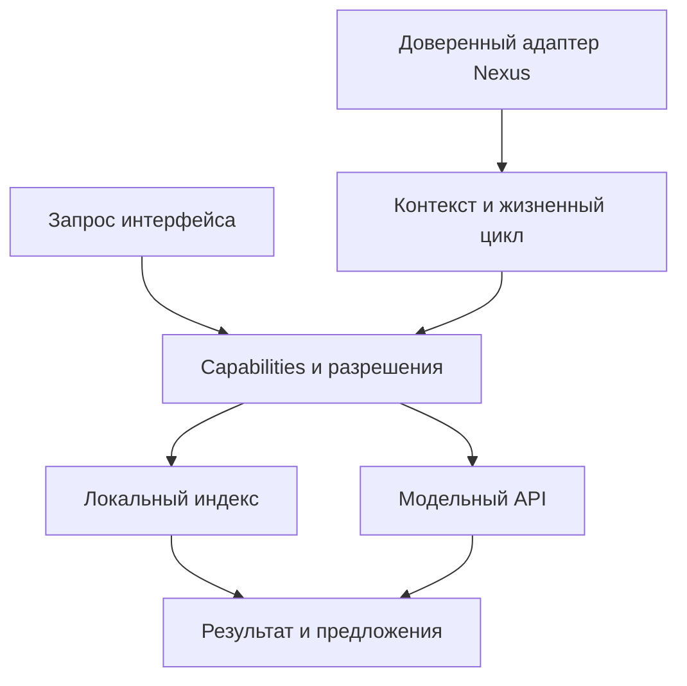

# AKRONIKL-0 — архитектура внутреннего ядра

Дата: 26.10.2026. Версия Core: `0.1.0`; версия контрактов: `1`.
Состояние документа: архитектура implementation candidate. Фактические результаты тестов и итоговый статус milestone фиксируются отдельным отчётом.
Исходный commit Nexus: [`065606a788198045cadf250fea663246ddbb2d56`](https://github.com/qsqgjhngyt-maker/akronikl-it-nexus/tree/065606a788198045cadf250fea663246ddbb2d56).

## Ответственность и границы

По решению владельца и MASTER от 26.10.2026 ветка **08 · INTELLIGENT ASSISTANT** целиком ведёт проектирование, реализацию, интеграцию и развитие Akronikl. MASTER 00 координирует связи с 01–07, диплом, приоритеты и решения о выпуске. Несовместимые изменения чужого контракта требуют согласования; публикация в `main` и production — отдельного разрешения владельца.

Обязательная архитектура: **Offline-First Core + Optional Local AI + Optional External AI Providers**. AKRONIKL-0 создаёт основу этой архитектуры. Реальные модели, голос, адаптивное обучение и подключение к production UI в этот кандидат не входят.

| Этап | Предмет | Статус относительно этого кандидата |
|---|---|---|
| AKRONIKL-0 | Контекст, capabilities, локальный индекс, предложения действий, модельный контракт | Текущий этап; проверяется по evidence |
| AKRONIKL-1 | Учебный наставник и помощь в Code Studio | PLANNED |
| AKRONIKL-2 | Голос и персонализация | PLANNED |
| AKRONIKL-3 | Внешние API и безопасный BYOK | PLANNED; внешние вызовы закрыты |
| AKRONIKL-4 | Реальные локальные языковые модели | PLANNED |
| AKRONIKL-5 | Skill Graph, Events, Mastery, Learner Model | PLANNED; зависит от фактических контрактов Nexus |

Рабочий режим: «Высокий»; security/BYOK/release gates — «Очень высокий»; исследования моделей — Pro.

## Компоненты



| Модуль | Ответственность |
|---|---|
| `akronikl/core/index.js` | `createAssistantCore`, диспетчеризация, policy, отмена, контроль жизненного цикла, единый результат |
| `contracts.js` | Версия, ограниченные типы/размеры, проверка обычных объектов, коды ошибок |
| `context.js` | Allowlist контекста, проверка принадлежности диагностик, `createNexusContextAdapter` |
| `studio.js` | Выбранный диапазон CodeWorkspace и адаптация настоящего `parseRuntimeError` |
| `capabilities.js` | Закрытый реестр разрешённых типов операций |
| `knowledge.js` | Проверка подготовленного индекса и детерминированный лексический поиск |
| `offline.js` | Проверка bytes/SHA256 локального пакета по доверенному manifest через внедрённый reader |
| `model-api.js` | Единый `generate` для доверенных адаптеров; закрытый внешний транспорт |
| `tools/build-akronikl-knowledge.mjs` | Воспроизводимая сборка индексов из существующих материалов |

Core не импортирует DOM, Nexus storage, HTTP-клиент, редактор или runtime. Доступ к приложению передаётся через доверенные функции host. Новый код не подключён к bootstrap, кнопке `askAkronikl`, роутеру или service worker. Изменение поведения этих компонентов относится к следующему этапу интеграции.

## API ядра и инструменты

Создание: `createAssistantCore({host, knowledge, providers, policy, timeoutMs})`.
Результат: `{version, invoke, invalidate, dispose}`. `invoke(request, {signal})` асинхронен; результаты заморожены и отделены от исходных данных.

| Capability | `input` | Поведение |
|---|---|---|
| `assistant.capabilities` | `{}` | Метаданные capabilities, провайдеров и флагов модели |
| `context.current` | `{include?: ['selection', 'diagnostics']}` | Проверенный снимок текущего контекста |
| `knowledge.search` | `{query, locale?: 'ru'/'en', limit?: 1..10}` | Материалы с источниками; пустой запрос требует уточнения |
| `navigation.propose` | `{lessonId, locale?: 'ru'/'en'}` | Предложение открыть урок, найденный в индексе |
| `model.generate` | `{providerId, prompt, include?: [...]}` | Вызов разрешённого локального адаптера через единый контракт |

Все запросы имеют форму `{capability, input}`. Произвольные tools, административные команды, запись файлов, запуск кода, PUSH/PULL и изменение прогресса отсутствуют. Результат `navigation.propose` содержит `{kind: 'navigation.proposal', target: {courseId, lessonId}, requiresUserGesture: true}`. Ядро не выполняет переход; host обязан проверить актуальность предложения и текущие разрешения перед действием пользователя.

Если locale не указан для поиска или навигации, после разрешения host используется `context.courseLocale`. Отсутствие подготовленного пакета этого языка означает `unavailable`; скрытого переключения на другой язык нет. Один экземпляр Core принимает не более одного индекса каждого locale; дубли отклоняются.

Общий результат:

```json
{
  "schemaVersion": 1,
  "coreVersion": "0.1.0",
  "requestId": "ak0-1",
  "capability": "knowledge.search",
  "status": "ok",
  "mode": "core",
  "text": "Понятное описание результата",
  "data": {},
  "sources": [],
  "actions": [],
  "error": null
}
```

`status`: `ok`, `empty`, `clarify`, `unavailable`, `denied`, `error`, `cancelled`. `mode`: `core` или `local-model`. Неизвестная команда отклоняется; пустой результат поиска не подменяется вымышленным ответом. Контролируемая ошибка содержит код, без raw stack, provider body или пользовательского запроса.

## Доверенный host и жизненный цикл

`host` предоставляет три функции:

1. `readBoundary()` возвращает непрозрачный объект текущего контекста либо `null`, если доступ не готов. Сравнивается идентичность объекта, а не `accountId`.
2. `authorize({capability, input}, {boundary, signal})` возвращает строго `true`, только если операция разрешена текущим контрактом Nexus.
3. `readContext({include, signal})` возвращает данные актуального маршрута и явно выбранной части редактора.

Host обязан создавать новую boundary на каждом переходе жизненного цикла и вызывать `core.invalidate()`: logout/lock, смена аккаунта, проекта, урока, редактора или ревизии выбранного кода. Это относится и к последовательности **A → B → A**. По одинаковым строковым ID нельзя отличить прежнюю сессию от новой. `dispose()` окончательно закрывает экземпляр; `invalidate()` отменяет текущие запросы, сохраняя возможность новых.

Ядро повторно проверяет boundary и свой epoch после асинхронных операций и перед возвратом результата. Есть таймаут и `AbortSignal`. Провайдер должен соблюдать отмену; ядро может прекратить ожидание, но не способно принудительно остановить произвольный JavaScript адаптера. Серверные ACL, Nexus Account, HttpOnly и Cloud Sync остаются авторитетными для своих данных; локальная policy их не заменяет.

## Контекст Академии и Code Studio

`createNexusContextAdapter` принимает `readBoundary`, `readRoute`, `readLegacyContext`, `readSelection`, `readDiagnostics`, `readLocale`, `readCourseLocale` и `authorize`. `readCourseLocale` по умолчанию совпадает с `readLocale`, но host должен передать отдельное значение, если язык курса отличается от языка помощника. Адаптер не подписывается на события приложения автоматически. Фактическое wiring жизненного цикла и сигналов аккаунта требуется при UI-интеграции.

`route` содержит только `view`, `courseId`, `lessonId`, `projectId`, `taskId`. Учебные поля legacy `akronikl/context.js` принимаются лишь при совпадении курса и урока с актуальным маршрутом. Legacy code/stdin/stdout/stderr/attempts не используются. Сам legacy singleton и существующие способы записи прогресса остаются неизменными.

Экспортированный `routeFromNexus(raw)` сопоставляет реальные ключи маршрута `course/lesson/project` с `courseId/lessonId/projectId`, определяет представление lesson/practicum и отклоняет конфликтующие пары старого и нормализованного ключа. Это адаптер данных; маршрутизатор Nexus он не заменяет.

По умолчанию контекст содержит locale, courseLocale, route и доступные учебные идентификаторы. Выбранный код добавляется только при `policy.selection === true`, явном `include: ['selection']` и разрешении host. Диагностика дополнительно требует `policy.diagnostics === true` и одновременного выбора `selection`. Допускается диагностика текущего файла и его ревизии; устаревшая отклоняется.

Selection: `filePath`, `languageId`, `revision`, `code`, необязательные `startLine/endLine`. Диагностика: реальный `source` (`compiler`, `runtime`, `static-analysis`), `severity`, `message`, `filePath`, `revision`, необязательные `line/column`. Это перенос настоящей диагностики, без утверждения о готовом интеллектуальном объяснении ошибки.

`selectionFromCodeStudio(snapshot, {filePath, startOffset, endOffset})` принимает настоящий снимок CodeWorkspace, выбирает только явный непустой диапазон конкретного файла и сохраняет ревизию. Весь файл не выбирается автоматически. `diagnosticFromNexus(parsed, {selection, runRevision})` адаптирует DTO настоящего `parseRuntimeError`, проверяет совпадение файла и ревизии запуска, сохраняет сообщение диагностики в пределах лимита. `providerLimit` отклоняется, чтобы ограничение runtime не было выдано за ошибку обучающегося.

Контекст не включает целиком storage, account credentials, hidden admin data, unrelated projects или историю диалога. Выбранный пользовательский код и диагностика всё равно могут содержать секреты: allowlist и лимиты размера не являются универсальным средством удаления секретов. Внешняя передача на AKRONIKL-0 закрыта.

## Offline knowledge index

`createKnowledgeIndex(bundle)` возвращает `search`, `getLesson`, `getSources`, `stats`. Индексы `core-index.ru.json` и `core-index.en.json` создаются отдельно. Источники — фактические curriculum, Gold allowlist и существующие материалы C++; пользовательские проекты в них не входят.

В пакеты извлекаются вступления/цели, теория и терминология. Готовые решения, ответы контрольных заданий и произвольные executable actions не индексируются. Для каждого фрагмента сохраняются sourceId, реальный путь источника, его SHA256, язык, section и typed route. `contentVersion` определяется отпечатками исходных файлов; manifest содержит состав и hashes самих пакетов. Проверка схемы runtime не заменяет проверку целостности доставленного пакета.

Точный объём и покрытие брать из `akronikl/knowledge/manifest.json`. На исходном наборе это 46 Gold-уроков на RU/EN плюс оставшиеся материалы/метаданные curriculum; два JSON вместе занимают примерно 1,1 MB без сжатия. В EN для части уроков имеются только заголовки: они отмечены в manifest, не считаются переведённой теорией. Locale не меняется скрыто, поиск не генерирует перевод или объяснение.

Подготовка: `node tools/build-akronikl-knowledge.mjs`. Проверка воспроизводимости без записи: `node tools/build-akronikl-knowledge.mjs --check`.

Для подготовки используется `loadPreparedKnowledge({descriptor, readBytes, subtle?, signal?})`. Descriptor берётся из доверенного manifest выбранной версии приложения и содержит `locale`, фиксированный `path`, `bytes`, `sha256`, `id`, `contentVersion`. Внедрённый `readBytes(path, {signal})` возвращает `Uint8Array` подготовленного ресурса. Loader проверяет разрешённый локальный путь, длину, SHA256 через WebCrypto, UTF-8, JSON, идентичность версии и схему, затем возвращает готовый index. Он поддерживает отмену и отклоняет повреждённый пакет.

Доверие к manifest обеспечивает host: совпадение SHA256 с подменённым вместе с пакетом descriptor не доказывает происхождение данных. Сам loader не выполняет сеть или storage; конкретный reader обязан соответствовать офлайн-политике приложения. Cache.put, загрузка ресурсов и обновление service worker не включены в Core. Наличие индекса не гарантирует доступность полного тела найденного урока офлайн. Для холодного запуска без сети отдельно готовятся core-модули, index и ресурсы интерфейса.

## Единый модельный API

Адаптер: `{id, kind: 'local'/'external', label?, modelId?, generate(input, {signal})}`. Вызов получает ограниченный контекст и prompt; возвращает `{text}`. `stream` и модельные tool calls ещё не реализованы. Из интерфейса следует обращаться через `core.invoke`, чтобы сохранялись policy, отмена и lifecycle-проверки.

`providers` по умолчанию пуст; `policy.localModels` выключен. Тестовый локальный адаптер позволяет проверить протокол, но не означает поставку языковой модели или подтверждённую работу inference на устройстве. Любой `external` адаптер отклоняется до исполнения безусловно. Его нельзя включить полем `allowExternal`, ключом или consent внутри пользовательского запроса.

Ответ модели маркируется `generated: true, grounded: false`; из него не исполняются tools/actions/URL. Текст отображается будущим UI как недоверенные данные. Адаптеры — доверенный код приложения, а не подключаемый произвольный JavaScript пользователя; Core не является security sandbox для их функций.

## Проверки и ограничения

Приёмка требует реального native ESM import, положительных операций по существующим IDs, детерминированной пересборки индекса, отрицательных проверок схем/разрешений, отмены после смены контекста, отсутствия неявной сети/storage, нормализованных ошибок и сохранности существующего кода. Выполнение модулей в Node не заменяет браузерную проверку. Результаты с командами и output сохраняются в отдельном evidence.

Следующий integration gate: реальное подключение host к Account/route/editor lifecycle; проверка UI, доступности, locale, сохранности прогресса, offline preparation, холодного запуска и обновления PWA; измерения загрузки/навигации на Desktop, Android и iPhone. До него отсутствуют основания для `LIVE PASS`, `FULL LIVE PASS` или заявления об улучшении производительности Nexus.

В данном milestone не подтверждаются BYOK security, реальные LLM, голос, обучение модели, Skill Graph, Learning Events, Mastery и Learner Model. Долговременное хранение диалогов, кода и персонального профиля также не реализовано.

Основания: [Context Engine](../10-ai-research/CONTEXT_ENGINE_SPEC.md), [Model Provider Abstraction](../10-ai-research/MODEL_PROVIDER_ABSTRACTION.md), [Grounding Contract](../10-ai-research/RAG_GROUNDING_CONTRACT.md), [AI Safety Threat Model](../10-ai-research/AI_SAFETY_THREAT_MODEL.md), [ADR-AK0-001](ADR-AK0-001-OFFLINE_CORE.md).
